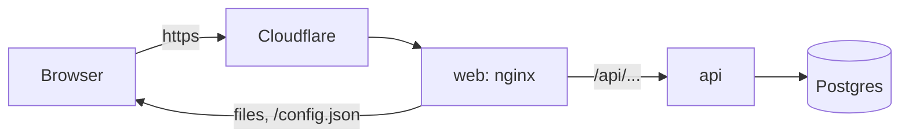

# Architecture

How the parts of the app fit together.

## 1. Images and apps

The repository builds three images, listed in `platform.yaml`. Each Environment runs them as two apps of one stamp, a Container Apps environment in Azure:

| Image | Built from | Runs as | What it does |
| --- | --- | --- | --- |
| `web` | `web/Dockerfile`, context `web/` | The app `web`, with a public hostname | nginx serving the React build on port 8080, and passing `/api` to the API |
| `api` | `src/Api/Dockerfile` | The app `api`, with internal ingress and no hostname | The .NET API on port 8080 |
| `migrator` | `src/Migrator/Dockerfile` | The init container of `api` | Migrates the database, then exits |

Every image runs as a non-root user. Both apps listen on port 8080 and answer `/healthz` and `/readyz`, which the platform probes.

## 2. Where data lives

The data is in Postgres, which comes from the stamp, not from this repository. In a dev stamp it is a container next to the apps, `ca-<stamp>-postgres`, which keeps its data only while it runs: after a restart, the migrator and the seed data build it again. Where the stamp chooses a managed service, such as Neon, the data stays. Either way the app gets the same setting, `DATABASE_URL` ([configuration.md](configuration.md)).

The framework's modules keep their data in Postgres too, each in a schema of its own (`identity`, `auditing`, and so on), and ship their own migrations in their packages. The app's own data is read and written through EF Core (`src/Api/Data/AppDbContext.cs`), in the `public` schema; its schema is the EF Core migrations in `src/Api/Data/Migrations/`. Every row the framework writes is stamped with the one tenant of the app ([section 6](#6-the-framework)).

## 3. Migrations

`migrator` runs before `api`, in every replica of every new revision:

1. It waits for Postgres, then takes a Postgres advisory lock, so only one replica migrates at a time.
2. It applies the migrations of every registered module, then each module's seed data: the roles, and the first administrator (`TenancyOptions:SingleTenant:AdminEmail`, with the password `SEED_ADMIN_PASSWORD`). Then it applies the app's own migrations.
3. Only where `SEED_TEST_DATA` is `true`, it adds the test data (`src/Migrator/TestDataSeeder.cs`): a demo user and the sample items. The framework's `seed-demo` is refused in single-tenant mode, because it creates demo tenants, so the app has its own seeder. Never set it where real people sign in.
4. It exits. Then `api` starts.

The framework's own migrator is a host of its repository, not a package, so this one is the app's, on the same building blocks, for single-tenant mode only.

The other replicas wait for the lock, find nothing left to do and exit. When the migrator fails, the new revision never becomes ready, and the previous revision keeps serving. So a revision never serves on a database it doesn't know.

The previous revision runs on the migrated database until the new one is ready, so every migration must be backward compatible ([deployment.md](deployment.md)). Not yet: in development mode breaking changes are allowed (`AGENTS.md`, "Development mode").

## 4. A request, from the browser to the database

- The browser talks only to `web`, on the app's hostname, through Cloudflare. In a sandbox, Cloudflare Access asks for a sign-in first.
- nginx answers the files of the React build. A path that isn't a file gets `index.html`, and the router in the browser shows the page.
- nginx passes every request under `/api` to `api`, at `http://ca-<stamp>-api` inside the stamp, with the path unchanged. The page and the API share one origin, so the API needs no CORS settings.
- `api` answers from Postgres.

Every endpoint of the API needs a signed-in user unless it opts out with `.AllowAnonymous()`: the sample's items and `/api/health/info` do, so the public part of a product is explicit. Sign-in is the framework's Identity module: `POST /api/v1/identity/token/issue` with an e-mail and a password, with no tenant header. Production hostnames are public, so a product decides which endpoints stay anonymous before its first production stamp. An app with a public part and a few staff pages uses the optional staff area under `/admin`, guarded by the same Identity ([staff-area.md](staff-area.md)).

## 5. The front end

`web/src/main.tsx` loads `/config.json` first, starts i18n with the deployment's default language, then renders the app. `App.tsx` holds the routes and the layout; each feature is a folder in `web/src/features/`, and calls the API at the relative path `/api`. The build writes `web/dist/`, which the image serves; hashed files under `/assets/` are cached for a year.

The front end is built on `@trislabcompany/framework-ui`, the framework's npm package: `web/src/i18n.ts` sets up i18next with `createFrameworkI18n`, and the header has its `LanguageSwitch`. Every text is in English (`en-US`) and Slovenian (`sl-SI`): English is in the main bundle, Slovenian is one lazy chunk, loaded when chosen. A text is added to both `web/src/locales/en-US/<namespace>.json` and `sl-SI/`, and read with `t()`; `web/src/i18n.test.ts` fails on a key one language lacks or on different `{{placeholders}}`.

## 6. The framework

The API is a modular monolith on the packages of `tl-framework`, one version for all of them (`TrislabFrameworkVersion` in `src/Directory.Packages.props`). `Program.cs` is the framework's host: `AddTrislabTenancy(t => t.UseSingleTenant())` first, then `AddTrislabPlatform`, the outbox (`AddEventingCore`) and `AddModules`; `UseTrislabTenancy` and `UseTrislabPlatform` build the pipeline. The modules and what each does are in [modules.md](modules.md).

- **Single tenant.** The app has one tenant, set in `TenancyOptions:SingleTenant` ([configuration.md](configuration.md#2a-tenancy-mode)): no tenant catalog, sign-up, plans or quotas, and a request names no tenant. The data is still stamped with the tenant, so the module code is the same as in a SaaS product.
- **Logs and correlation** come from the framework's logging ([.claude/rules/logging.md](../.claude/rules/logging.md)); this repository only configures it.
- **Mail** goes through Azure Communication Services Email over SMTP, with the framework's Mailing sender ([configuration.md](configuration.md#6-mail-through-azure-communication-services)).
- **Background jobs** (Hangfire, on Postgres) run in the API.
